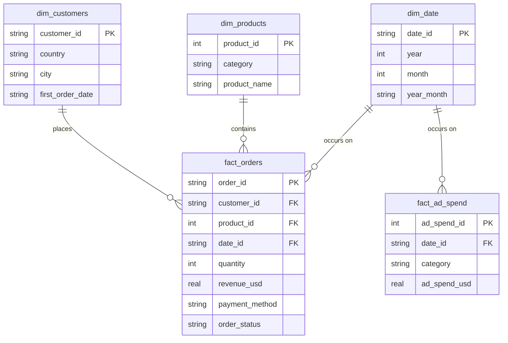

# E-commerce SQL Analytics — Star Schema & Business Queries


The SQL half of a two-part project. The [dashboard repo](https://github.com/MashhudFarah/ecommerce-sales-analytics)
cleans the same export with pandas and shows it in Excel and Streamlit. This one
does the modelling in SQLite: three dimensions, two fact tables, and eleven
queries written as SQL rather than pandas.

**Synthetic sample data.** I generated it to have something messy to work with —
not a real shop. The absolute numbers mean nothing; the modelling is the point.

## What it does

The raw export is 12,180 order rows and a daily ad-spend file. Both are messy in
the usual ways, and the ETL has to handle that before anything can be answered.
After loading, `queries.sql` answers the eleven questions listed below, and
`run_queries.py` regenerates `query_results.md` so the output in that file always
matches what the queries actually return.

```text
sql-project/
├── messy_data.csv        # raw orders export (untouched)
├── ad_spend.csv          # raw daily ad spend by category (untouched)
├── schema.sql            # star-schema DDL (3 dimensions, 2 facts)
├── etl.py                # cleans the raw CSVs, loads ecommerce.db
├── queries.sql           # 11 documented analytical queries
├── run_queries.py        # executes queries.sql, prints results
├── query_results.md      # full output of every query
├── ecommerce.db          # the built warehouse (tracked)
└── requirements.txt
```

## Data quality issues handled in the ETL

| Issue | Example | Fix |
|---|---|---|
| 5 date formats in one column | `09-23-2025`, `2025/07/27`, `10 Apr 2026` | Multi-format parser, tries each in priority order |
| 20 spellings of 6 payment methods | `NetBanking`, `net banking`, `Net Banking` | Lookup-table normalisation |
| 24 spellings of 7 countries | `UK`, `U.K.`, `uk`, `United Kingdom` | Lookup-table normalisation |
| 180 exact duplicate rows | the same order appearing twice | Dropped before load |
| Nulls in discount / rating / city | ~6,150 missing ratings | Explicit fill rules, not silently dropped |

## Schema

One grain-of-transaction fact table, one marketing fact table, three conformed
dimensions so both facts join cleanly on `date_id`.



## The eleven questions

1. Headline KPIs — total, fulfilled and lost revenue, AOV, cancel+return rate
2. Monthly revenue trend with month-over-month growth (`LAG`)
3. Running cumulative revenue (`SUM() OVER`)
4. Revenue, ad spend and ROAS by category (two CTEs joined)
5. RFM segmentation — recency, frequency, monetary, scored with `NTILE(4)`
6. Monthly cohort retention, months 0–3, per signup cohort
7. Repeat purchase rate
8. Top 10 customers by lifetime value (`DENSE_RANK`)
9. Revenue, AOV and cancellation rate by country
10. Payment method mix and AOV
11. Cancellation and return rate by category

## Sample results

**Headline** — 12,000 clean orders, $1.39M total revenue, $767K fulfilled, $116
AOV, 18.4% cancel/return rate.

**RFM segments**

| Segment | Customers | Avg value | Avg recency (days) |
|---|---|---|---|
| Champions | 782 | $480.26 | ~115 |
| At Risk (high value) | 485 | $413.25 | ~441 |
| Needs Attention | 209 | $122.23 | ~212 |
| New / Promising | 548 | $114.37 | ~126 |
| Lost / Churned | 930 | $110.64 | ~560 |

The 485 high-value customers in "At Risk" haven't ordered for about 14 months on
average — the first list a win-back campaign would start from. On synthetic data
the segments are a demonstration of the method, not a finding.

**Category ROAS** — Electronics 2.35x, Grocery 1.72x. Full ranking in
`query_results.md`.

**Retention** — every cohort loses over 90% of its customers by month 1 and then
flattens. The repeat purchase rate is 66.8%, so people do come back — just not
within 30 days. Whether that's a problem depends on the email and remarketing
cadence, which this dataset can't tell you.

**Country** — Australia leads on revenue at $367.8K. Germany has the lowest
cancel/return rate at 17.1%. The US is next at 17.6%, on the smallest volume.

Full output for all eleven queries is in [`query_results.md`](query_results.md).

## Limits

- Only one warehouse engine is tested — SQLite 3.25+. The syntax is standard ANSI
  and should run on PostgreSQL and MySQL 8+, but I haven't run it there.
- The dataset is synthetic. Some of the patterns (the retention cliff in
  particular) may be artefacts of how I generated it rather than anything real.
- AOV here is gross revenue divided by order count. If you want it on fulfilled
  revenue only, it's a one-line change in query 1.
- No incremental loading. `etl.py` rebuilds `ecommerce.db` from scratch every run,
  which is fine at 12,000 rows and wouldn't be at 12 million.
- No tests. The queries are checked by reading the output, not by assertion.

## Run it

```bash
pip install -r requirements.txt
python3 etl.py            # rebuilds ecommerce.db from the raw CSVs
python3 run_queries.py    # runs all 11 queries, regenerates query_results.md
```

Or open `ecommerce.db` in DB Browser for SQLite and run `queries.sql`
query-by-query.

## AI

I used AI tools to help write and debug the SQL and the ETL. I ran every query
myself and checked the outputs against the raw CSVs before putting any number in
this README.

## Notes

- Every window function and CTE here is standard ANSI — it should run unmodified
  on SQLite 3.25+, PostgreSQL and MySQL 8+.
- Same source data as the [dashboard repo](https://github.com/MashhudFarah/ecommerce-sales-analytics).
  That one is the pandas and dashboard layer; this one is the warehouse layer.

## Definitions

The dashboard repo is looser: it counts shipped and pending orders as
fulfilled, which gives $1.15M and an average ROAS of 2.94x. This repo counts
only delivered orders, so its numbers are lower. Same data, different
definition.

- **Gross revenue** — every order including cancelled and returned. $1.39M.
- **Fulfilled revenue** — only `order_status = 'Delivered'`. $767K.
- **Lost revenue** — cancelled and returned. $252K.
- **Shipped and pending** — about $373K. In gross revenue, but in neither
  fulfilled nor lost.
- **Ad spend** — from the sample ad-spend file. ~$375K.
- **ROAS** — fulfilled revenue divided by ad spend, so cancellations don't
  inflate it.
- **Revenue after ad spend** — fulfilled revenue minus ad spend. ~$392K. Not
  profit — no cost of goods, shipping or platform fees.

Cancelled and returned orders count in gross revenue but are excluded from
fulfilled revenue, ROAS, cohort retention, RFM and repeat-purchase metrics.
